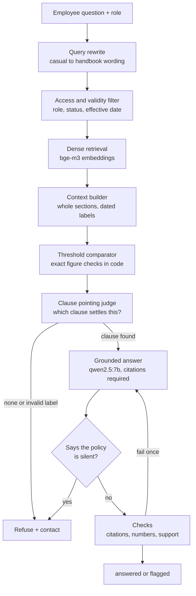

# Policy RAG

A fully local question answering assistant for a company policy handbook. Employees ask in plain language, and the system answers with citations to the exact clause, respects who is allowed to see what, and refuses to guess when the handbook does not say.

Everything runs on a laptop with Ollama. No cloud API, no data leaves the machine. The sample corpus is a fictional handbook for "Meridian Works Sdn Bhd" (14 policies, 15 DOCX and PDF files, 182 searchable clauses and tables).

## What it does

- **Cited answers.** Every statement carries a clause label such as `[POL-02 §1.1]`. Labels are checked against the clauses actually shown to the model.
- **Role based access.** Five roles (employee, manager, hr, finance, executive). Restricted clauses are filtered out before any search, so forbidden text is never scored, shown or leaked.
- **Version and date awareness.** Superseded policy versions and policies not yet in force are never retrievable. When two current policies disagree, dates are shown to the model so the later one wins.
- **Refusal and escalation.** When no clause answers the question, the assistant says so and names the right contact (HR, Finance, IT Security and so on).
- **Honest verification.** Answers that fail a check are returned with a `flagged` status instead of being passed off as confident.
- **Exact number handling.** Code, not the language model, compares the employee's figures against clause thresholds ("4 years against less than 5 years", "RM 350 against the RM 200 to RM 500 band").

## Architecture



| Step | File | Notes |
|---|---|---|
| Parsing | `parsing/` | DOCX by heading styles and the document control table, PDF by layout. Tables become one line per row. |
| Filtering | `filters.py` | Runs before search. |
| Retrieval | `retrieve.py`, `index.py` | Dense, BM25, hybrid, reranked and blended modes are all implemented and evaluated. Dense is the default. |
| Rewrite | `rewrite.py` | One short model call. |
| Judge | `judge.py` | Names a clause label, validated against the shown context. |
| Thresholds | `thresholds.py` | Parses figures, ranges and grade bands from question and clauses. |
| Answer and checks | `assistant.py`, `verify.py`, `prompts.py` | Structural checks are deterministic. Only the support check uses the model. |

## Results

All numbers are produced by the scripts in this repo and the raw outputs are in `eval/results/`. Two question sets exist. A tuned set of 66 questions (58 answerable, 8 not) was used while developing. A separate held-out set of 32 questions (19 answerable, 13 not) was kept out of prompt tuning.

### End to end, tuned set (66 questions)

| Measure | First full run | Current (p3e) |
|---|---|---|
| Answerable questions answered | 84% | **100%** |
| Citation validity | 100% | **100%** |
| Fact checks (13 questions with a known figure) | 92% | **100%** |
| Flagged by verification | 6% | 5% |
| Correct refusal | 100% | **100%** |
| Restricted clauses leaked | 0 | **0** |
| Mean seconds per question | 10.1 | **5.2** |

### End to end, held-out set (32 questions)

| Measure | First run (h1) | Latest (h4) |
|---|---|---|
| Answerable questions answered | 100% | **100%** |
| Citation validity | 100% | **100%** |
| Citation recall | 95% | 95% |
| Fact checks (17 questions) | 94% | **100%** |
| Flagged by verification | 16% | **5%** |
| Correct refusal (13 questions) | 85% | **100%** |
| Restricted clauses leaked | 0 | **0** |
| Mean seconds per question | 4.6 | 4.9 |

Two held-out failures (a question about Ramadan hours and one about HR investigations) guided the refusal fix, so the held-out set is no longer fully untouched. A fresh set is the next evaluation step.

### Retrieval ablation (58 answerable questions, top 5 clauses)

| Mode | Hit@1 | Hit@3 | Hit@5 | MRR |
|---|---|---|---|---|
| BM25 only | 0.552 | 0.724 | 0.793 | 0.659 |
| Hybrid (dense + BM25, fused) | 0.759 | 0.914 | 0.983 | 0.846 |
| Hybrid + cross-encoder rerank | 0.862 | 0.931 | 0.983 | 0.899 |
| Dense only (bge-m3) | 0.862 | 0.931 | 0.983 | 0.909 |
| Dense + query rewrite | **0.897** | **0.948** | 0.983 | **0.931** |

Dense retrieval matched the reranked hybrid on this corpus and is simpler and faster, so it is the default. Query rewriting added a few points on casual questions. Policy violations (forbidden, restricted or superseded clauses returned) were 0 in every mode.

## What failed and why

The numbers above came from a sequence of failures, each diagnosed with a script before fixing.

1. **A yes/no "is this answerable" judge refused correct questions.** The 7b model was over literal and refused even when the right clause was the only context shown. A diagnosis script separated retrieval faults from judge faults and proved the judge was the problem. Replacing it with a "point at the clause that settles this" task, with the label validated against the shown context, took answered rate from 88% to 100% with no loss in refusal.
2. **Questions took 14 seconds.** The embedding model and the language model were evicting each other from GPU memory. Running the small embedding model on the CPU removed the reloads and cut the judge step to about 2.4 seconds per question.
3. **The model got number comparisons wrong, in both directions.** It said 3 years does not meet "less than 5 years" and applied the RM 500 tier to RM 350. Prompt wording only moved the errors around. A deterministic comparator now computes each comparison and hands the model plain sentences such as "the employee's RM 350 does NOT meet 'more than rm 500'". Fact checks went from 92% to 100%.
4. **The model ignored an instruction to abstain.** Asked to reply `NOT_IN_POLICY` when no clause applied, it wrote "the policy does not specify..." instead and the answer went through. A small deterministic detector for those phrases now turns such answers into refusals. It was tested against every saved answer and caught none of the answers that correctly state a rule, for example "sabbatical leave is not provided".
5. **A verifier bug.** The number check only looked for digits in the question, so "four years" in the question and "4-year" in the answer was flagged as an invented number. Spelled out numbers in the question now count.

## Limitations

- The 7b support check still raises some false alarms on correct answers, and it can miss wrong ones. Flagged answers are returned with a warning rather than blocked.
- The threshold comparator and the silence detector were built from this handbook's phrasing. A different handbook would need new patterns and a new evaluation.
- The evaluation sets are small and were written by the author. Results vary slightly between runs because the model is not fully deterministic.
- The corpus is fictional and English only.

## Quick start

Requires Python 3.12 and [Ollama](https://ollama.com).

```powershell
python -m venv .venv
.venv\Scripts\activate
pip install -r requirements.txt
ollama pull qwen2.5:7b
ollama pull bge-m3
```

Build the index, then ask a question.

```powershell
python src\policy_rag\cli_index.py
python src\policy_rag\cli_ask.py "can i wfh everyday?"
python src\policy_rag\cli_ask.py "what bonus does a grade 5 get?" --role hr
```

Run the tests and the evaluations.

```powershell
python -m pytest -q tests
python src\policy_rag\evaluate.py --label retrieval
python src\policy_rag\evaluate_e2e.py --label full
python src\policy_rag\evaluate_e2e.py --label holdout --golden eval\golden_holdout.json
python src\policy_rag\diagnose.py
```

The sample handbook in `data/handbook` is generated from `handbook_src/*.md` by `tools/build_handbook.py`, which needs LibreOffice installed for the PDF files.

## Project layout

```
src/policy_rag/    pipeline, checks, CLIs and evaluation scripts
tests/             unit tests with scripted fake models (no Ollama needed)
eval/              golden question sets and saved results
data/handbook/     sample DOCX and PDF policies
handbook_src/      markdown source of the sample handbook
docs/              notes on the corpus and planted test cases
tools/             handbook generator
```

## Roadmap

- A fresh unseen question set for the final measurement.
- FastAPI backend and a React chat interface with a role switcher, clickable citations and a visible flagged or refused state.
